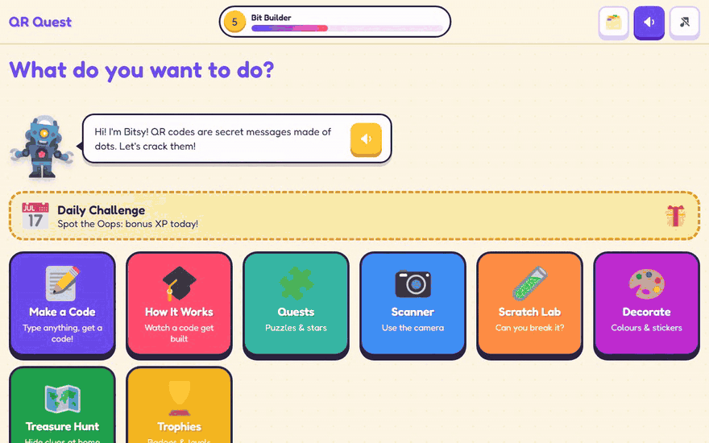
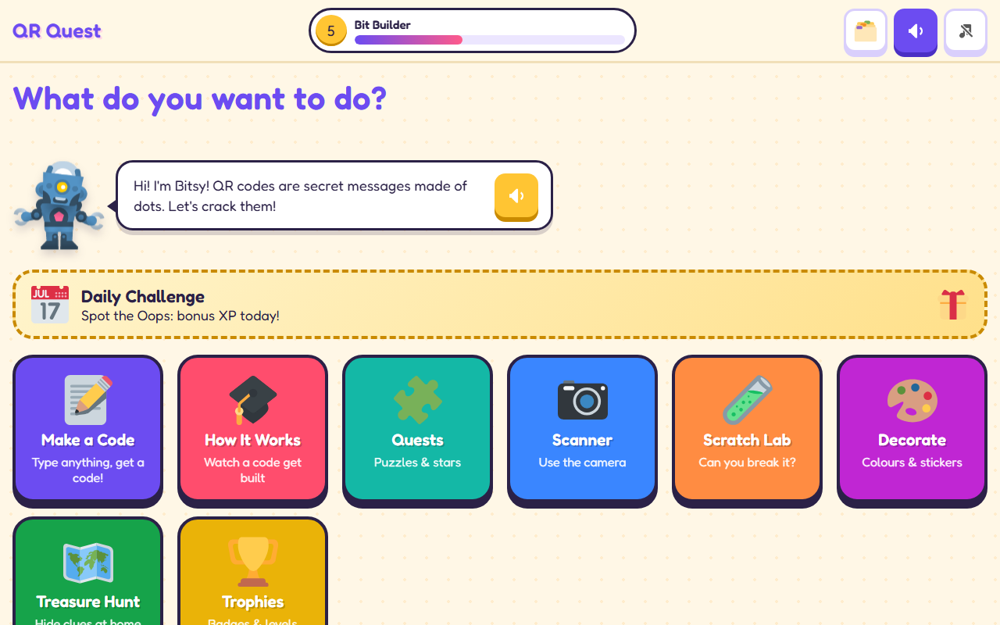
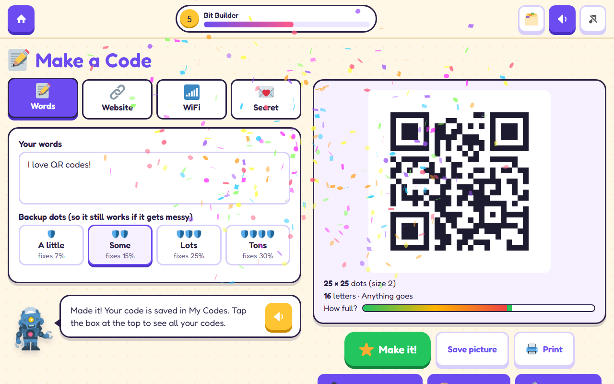
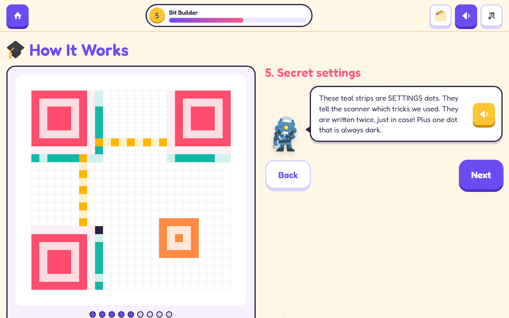
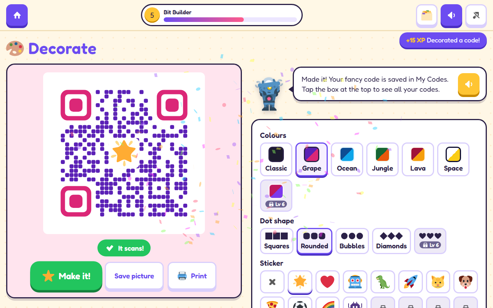
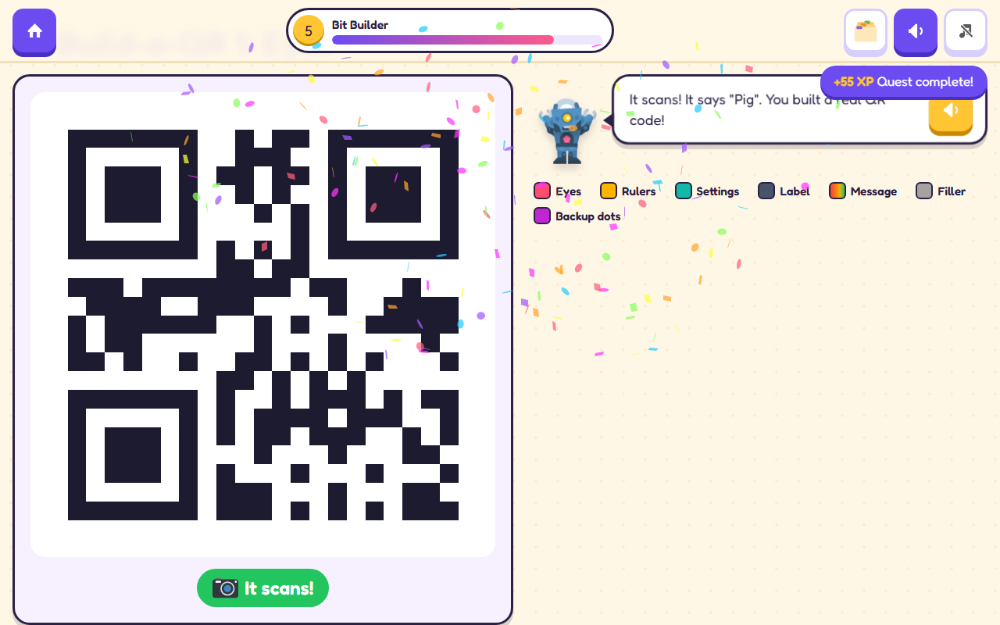
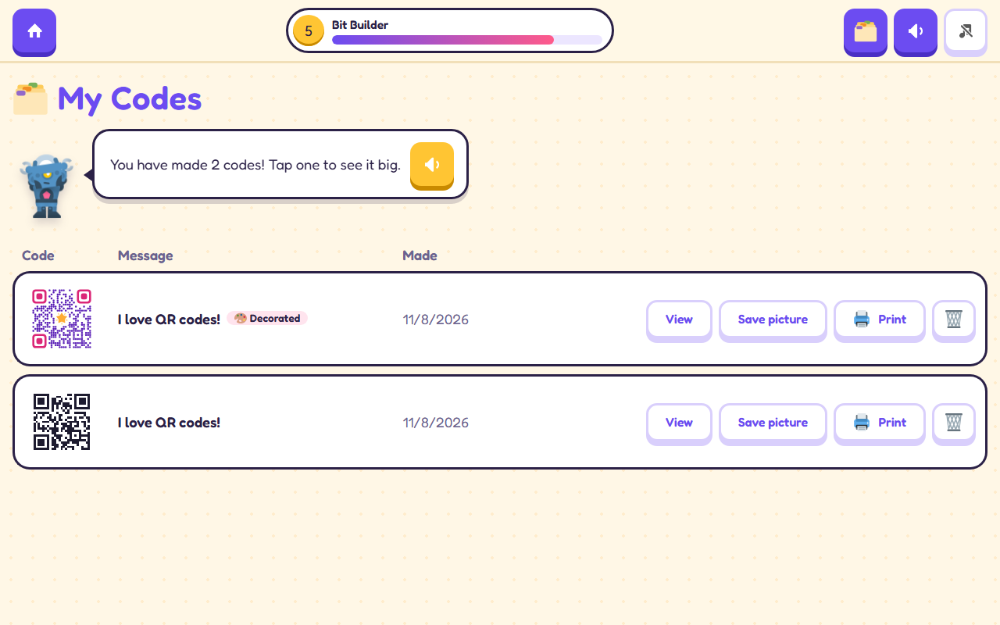

<div align="center">


# QR Quest

**Make, decorate and scan QR codes, then watch them get built dot by dot and find out what every dot does. A QR code workshop for kids.**

[](https://github.com/Troy-Story-Games/qr-quest/releases/latest)
[](https://github.com/Troy-Story-Games/qr-quest/actions/workflows/pages.yml)
[](https://github.com/Troy-Story-Games/qr-quest/releases)
[](LICENSE)
<br>


[**▶ Play now**](https://troy-story-games.github.io/qr-quest/) · [**Download**](#download) · [**Features**](#features) · [**Screenshots**](#screenshots) · [**Build from source**](#build-from-source)

<br>



<sub>20-second tour · <a href="docs/demo.mp4">watch as video (MP4)</a></sub>

</div>

## Why

QR Quest was made for a 7-year-old who loves QR codes. Most apps just spit out a code; this one shows how it's built. The three big "eyes", the rulers, the settings, your letters turned into bits, the backup dots and the mask. Then you can scratch codes to see the backup dots save the day, decorate them, scan real ones, and hide them around the house for a treasure hunt.

- **Learn by doing**: quests and a six-level Build-a-QR map where you put a real, scannable code together by hand
- **See the invisible**: tap any dot to find out its job
- **Gamified**: XP, levels, stars, badges, streaks, a daily challenge and unlockable styles
- **Works anywhere**: tablets, Chromebooks, phones, and as a desktop app, online or offline

## Download

Play in the browser at **[troy-story-games.github.io/qr-quest](https://troy-story-games.github.io/qr-quest/)**. On a tablet or Chromebook, tap **Install app** on the home screen to add it like a real app (it works offline too).

Desktop apps are on the [Releases page](https://github.com/Troy-Story-Games/qr-quest/releases/latest):

| System | File |
| --- | --- |
| Windows | `qr-quest-<version>-windows-setup.exe` (installer) or `qr-quest-<version>-windows-portable.exe` (no install) |
| macOS | `qr-quest-<version>-mac-arm64.dmg` (Apple Silicon) or `qr-quest-<version>-mac-x64.dmg` (Intel) |
| Linux | `qr-quest-<version>-linux-x86_64.AppImage` |

> The apps aren't code-signed. On **Windows**, click *More info* → *Run anyway* if SmartScreen appears. On **macOS**, right-click the app → *Open* the first time. On **Linux**, make the AppImage executable (`chmod +x`). Codes and progress are saved on the device; nothing is sent anywhere.

## Features

### ✏️ Make
- **Make a Code** from words, a website, WiFi details or a secret message, with a live preview, picture download and printing
- **Build it by hand**: put your own code together piece by piece
- **Decorate**: colours, dot shapes and stickers, with a live check that it still scans
- **My Codes**: everything you've made, ready to view, save or print

### 🔍 Learn
- **How It Works**: an animated, narrated build of your own code, step by step
- **Scratch Lab**: rub out dots and see how much damage each backup level survives
- **Quests**: Find the Eyes, Spot the Oops, the Build-a-QR level map, and a daily challenge

### 📷 Play
- **Scanner**: scan with the camera (or pick a photo) and find out what a code says
- **Treasure Hunt**: write clues, print the codes, hide them, then scan them to follow the trail
- Read-aloud for every explanation, sound effects and optional music

## Screenshots

| | |
| --- | --- |
|  |  |
|  |  |
|  |  |

## Build from source

Requires [Node.js](https://nodejs.org/) 24 (see `.nvmrc`).

```bash
git clone https://github.com/Troy-Story-Games/qr-quest.git
cd qr-quest
npm install
npm run dev          # http://localhost:5173
```

| Command | What it does |
| --- | --- |
| `npm test` | Unit tests (Vitest) |
| `npm run test:e2e` | End-to-end tests in tablet and phone viewports (Playwright; run `npx playwright install chromium` once first) |
| `npm run lint` | ESLint |
| `npm run build` | Type-check and build the static site into `dist/` |
| `npm run preview` | Serve the production build locally |
| `npm run electron:dev` | Run the desktop app against the dev server |
| `npm run electron:build` | Build a desktop app for your OS into `release/` |
| `npm run icons` | Regenerate the app icons |

To try it on a tablet on the same network, run `npm run dev -- --host` and open the printed network URL. The camera needs HTTPS or `localhost`, so test scanning on the deployed site or with the photo picker.

### How it's built

React 19, TypeScript, Vite, Zustand and Motion, with a QR encoder in `src/core/qr` that records what every dot means. It's a PWA for the web and uses Electron for desktop. There's no backend: everything runs and saves on the device.

```
src/
  app/          App shell: routing, top bar, reward pop-ups, shared state
  components/   Reusable UI (buttons, mascot, QR renderer)
  core/         QR encoder and payload formats (WiFi, URL, treasure clues)
  features/     One folder per screen (maker, how-it-works, quests, about, ...)
  game/         XP, levels, badges, quests, streaks and unlockables
  services/     Audio, speech, camera, install prompt, storage
electron/       Desktop app entry point
tests/          unit/ (Vitest) and e2e/ (Playwright)
```

## Made by TroyStoryGames

Made with ❤️ by **[TroyStoryGames](https://troystorygames.com)**. Also try **[Packet Pals](https://github.com/Troy-Story-Games/packet-pals)**, which builds networks and watches packets fly.

Art and sounds come from CC0 and openly licensed sources (Kenney, Twemoji and others). See [CREDITS.md](CREDITS.md).

## License

[MIT](LICENSE)
